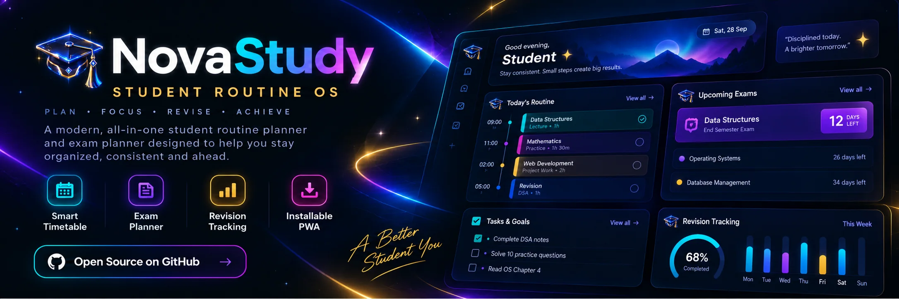

<p align="center"></p>

# ✦ NovaStudy — Student Routine OS

**A futuristic, responsive, offline-first student planner with installable PWA support.**

A free, no-login routine app for learners from early childhood to university / postgraduate studies. Supports Bengali education categories and a customizable international option.

## App isolation — NovaStudy v3.6.5

NovaStudy-Routine and Masum-Chronos are separate installable apps. NovaStudy keeps its own manifest identity, icon, start URL, service-worker scope, academic modules and authentication configuration. This release removes the optional Chronos widget panel and third-party Chronos loader from NovaStudy, so NovaStudy no longer embeds Chronos or sends study snapshots to it.

**Data safety:** this is a frontend/PWA separation change. It does not delete NovaStudy routines, tasks, exams, focus history, authentication, or any existing Supabase tables. The existing `chronos_missions`, `chronos_preferences`, and `chronos_backups` tables are left untouched. Tables in one Supabase project are still in the same Postgres database; keep them as-is for now, and use a separate Supabase project only if independent infrastructure is required.

For a clean install, open the canonical NovaStudy URL `https://gitwithmasum.github.io/NovaStudy-Routine/` and install from that page. If a previously installed shortcut still opens the wrong app, uninstall that shortcut first, then open the NovaStudy URL in Chrome and install again. The service-worker cache version is bumped to `novastudy-v3.6.5-isolated` so the app can download the isolated shell.

## Features

**Source update:** Browser code is split into core state, view renderers, modal editors, and event/controller modules for maintainability.

- **Education setup:** Primary School; Secondary School; Higher Secondary / College; Madrasah; Diploma / Technical / Vocational; University / Higher Education; Other / International / Custom.
- **Class / academic year, group / major:** Preset choices for school groups, college streams, technical departments, university majors (CSE, EEE, BBA, law, medicine, architecture, etc.) with editable subject suggestions.
- **Auto study planner:** Generate balanced study blocks for 1–7 days with adjustable start time, length, breaks and sessions/day; preserves existing entries and avoids clashes.
- **Timetable:** Add/edit/delete weekly sessions; day, start/end, course, location, session type. Detects overlap without blocking intentional overlaps.
- **Dashboard:** Today's timeline, total planned hours, pending missions, task completion.
- **Themes (v1.2):** Visual Cyber / Black & Gold theme selector in Settings, header toggle, mobile adjustments, and saved theme preference across refresh and same-origin tabs. Saved routines, subjects and tasks remain unchanged.
- **Missions:** To-dos with due dates, subject associations, priorities, completion, filtering and search.
- **Privacy:** Data is stored locally in your browser. No accounts, analytics, server databases, or external runtime dependencies.
- **Backup:** Export/import JSON; import asks for confirmation, checks basic backup format and limits file size.
- **PWA:** Add to Home Screen / installable on supported Android, iOS and desktop browsers. Service worker caches the app shell for offline use after a successful HTTPS visit.
- **Optional browser notifications:** Reminders work only while the app is open/active and browser APIs allow it. Background push notifications are not implemented.

> Subject lists are **starter suggestions, not claims of exact or official curricula**. Actual subjects vary by board, country, institution and semester; add, delete or rename any subject. The starter demo schedule is fictional.

## Quick start (VS Code)

No npm, database or paid hosting is required.

1. Download or clone the project and open the `NovaStudy-Routine` folder in VS Code.
2. Serve it from a local web server (opening `index.html` directly disables PWA/service worker features).
3. In the terminal, run either:

```powershell
npx serve . -l 5173
```

or, if you have Python installed:

```powershell
python -m http.server 5173
```

4. Open `http://localhost:5173`.

## GitHub repository and VS Code sync

Repository: https://github.com/gitwithmasum/NovaStudy-Routine

First-time clone:

```powershell
git clone https://github.com/gitwithmasum/NovaStudy-Routine.git
cd NovaStudy-Routine
```

To sync an already cloned folder:

```powershell
git pull --ff-only origin main
```

For future updates:

```powershell
git add .
git commit -m "chore: improve routine planner"
git push
```

GitHub repository URL: `https://github.com/gitwithmasum/NovaStudy-Routine`.

## Deploy to **Vercel** (recommended)

1. Open https://vercel.com/new and sign in with GitHub.
2. Select **Import Git Repository** → `NovaStudy-Routine`.
3. Framework Preset **Other** (it's native HTML/CSS/JS; **no build command**); Root Directory `./`; output uses project root.
4. Click **Deploy**.
5. Verify HTTPS URL, Add Session, Profile category, editing subjects, and PWA install prompt.
6. When Git integration is connected, pushes to `main` automatically redeploy.

Alternate CLI from the project folder:

```powershell
npm i -g vercel
vercel login
vercel --prod
```

The project includes `vercel.json`.

## Deploy to **Netlify** (third hosting option)

1. Open https://app.netlify.com/start and log in.
2. Add new project → Import an existing project → GitHub → `NovaStudy-Routine`.
3. Branch `main`; Build Command **leave empty**; Publish directory `.`.
4. Deploy. The `netlify.toml` file already sets `publish = "."`.
5. Ensure PWA works over Netlify's generated HTTPS site.

GitHub Pages is a **fourth** optional static host: GitHub repo → Settings → Pages → Deploy from branch → `main` / `(root)` → Save. Site is typically `https://gitwithmasum.github.io/NovaStudy-Routine/` when published. Relative asset paths and PWA scope are designed to support subfolder hosting.

## Install on a phone

- **Android Chrome:** Open the deployed HTTPS URL → tap the app's **Install app** button if an installation prompt is offered, or ⋮ menu → Install app / Add to Home screen.
- **iOS Safari:** Open HTTPS URL → Share → Add to Home Screen → Add. On iOS, browser notifications have platform restrictions; foreground reminders should not be relied upon for alarms.
- **Desktop Chrome / Edge:** Browser install icon in address bar or browser menu.

A PWA is installed from the browser. This project **does not** produce an Android APK or iOS IPA. Those require a separate packaging / native mobile release workflow (e.g., Capacitor, TWA or app store submission).

## Project files

```
NovaStudy-Routine/
├── index.html
├── styles.css
├── presets.js
├── core.js
├── views.js
├── editors.js
├── app.js
├── manifest.webmanifest
├── sw.js
├── assets/
│   ├── icon-192.png
│   └── icon-512.png
├── vercel.json
├── netlify.toml
├── QUICK_START_BN.md
├── .gitignore
├── LICENSE
└── README.md
```

## Roadmap ideas for v2

- Supabase / Firebase Auth and encrypted cloud sync for cross-device routines (do not enable without migration/backups)
- Server push notification scheduling, calendars, exam planner, routine templates, pomodoro
- Multi-language UI (Bangla + English), syllabus packs for specific boards, and smart clash resolver
- Accessible drag & drop and export to printable PDF / calendar ICS

## Data handling

- State is stored in `localStorage` under `novastudy_state_v1`. It can be lost when browser storage is cleared, incognito closes, or the browser profile changes.
- Backups are local JSON files. Use export regularly.
- Do not import JSON backups from untrusted people.
- A service worker caches public app files, **not** private data. No backend is required for v1.

## License

MIT — © 2026 Masum Billah.
## v1.3 — Smart Timetable & Exam Planner

- **Exams & revision** (desktop and mobile): add, edit, complete/reopen, or delete an exam with subject, date, start/end, location, and notes.
- **Countdown:** next upcoming exam appears on the dashboard, with dynamic device-local countdowns on the Exam page.
- **Repeat controls:** sessions can repeat weekly (optional end date), or occur once on a specific date. Existing saved timetable entries remain weekly by default.
- **Revision plan:** select an exam, session count, duration, and start time. NovaStudy adds dated **one-time revision sessions plus linked tasks**, shifting forward in 15-minute steps where needed to avoid clashes. Running again avoids duplicate dates; tightly spaced exams may result in fewer sessions.
- **Backward-compatible data:** existing `novastudy_state_v1` records and v1 JSON backup files remain valid; `exams: []` is initialized if missing. No need to reset local storage.
- **Privacy:** all data remains on the device. No cross-device sync or guaranteed background alarms.
- **Deleting an exam** does not delete existing revision sessions/tasks, preventing accidental loss of your study history.

### Try it
Select **Exams & revision → Add exam → Plan revision**. Check your **Weekly routine** for one-time blocks and **Tasks & goals** for linked revision to-dos.

### Graduation-cap app branding (v1.3.1)
The selected futuristic graduation-cap artwork is now the app icon for installable PWA (192px and 512px), browser favicon, Apple touch icon and sidebar/mobile navigation logo. Updated files preserve all previous routine and exam-planner features. If the old icon persists after updating, refresh/reinstall the installed app to clear old cached icons.


## v1.4 — Smart Reliability Update

- **Storage safety:** Invalid saves and storage quota failures restore the last successfully saved in-memory snapshot and show a persistent recovery notice, instead of reporting false success.
- **Backup safety:** Validate imported dates, times, duplicate IDs and session boundaries; write to localStorage before reporting recovery success. Previously supported version-1 backups without an exams array are accepted.
- **Corrupt storage:** Never silently overwrite an unreadable state. Download the original raw text for troubleshooting and import a known-good JSON backup from Settings.
- **Multi-tab sync:** Adopt valid state updates from another tab and close open editors to prevent stale changes. Saving from a stale tab is rejected if another write arrived first.
- **PWA updates:** Future updates can display an **Update and reload** prompt, which waits for user approval. The transition from v1.3.1 automatically activates the v1.4 service worker once to get past the older cache-first script loader; reload the app afterward if still on the old UI.
- **Tests:** Run `node --test tests/reliability.test.cjs`; no npm install or build is necessary.
- **Data:** The localStorage key, existing data format and Cyber / Black & Gold themes are unchanged. Vercel and Netlify have separate browser storage.


## NovaStudy v1.5 — Bangla & English Bilingual Experience

- Switch **English / বাংলা** with the header language button or **Profile & Settings → Language preference**. The choice persists in this browser and synchronizes between same-origin tabs via a separate `novastudy_language_v1` preference.
- English is the fallback. Bengali navigation, dashboards, routine/tasks/exams, forms, system messages, revision countdowns, accessibility labels, and selected education-category UI labels are displayed through `i18n.js`. Bengali month/day/date display uses `Intl` and local font fallbacks.
- **Data safety:** Stored `novastudy_state_v1` state, JSON backup structure, ISO dates, subject names, notes, student-entered titles and enum/form option values are not translated or modified. `novastudy_theme_v1` remains independent.
- **Mobile and PWA:** The header compacts on narrow devices; Install remains available under Settings. `i18n.js` is included in the v1.5 service-worker cache for offline use.
- **Tests:** Run `node --test tests/*.test.cjs` to execute v1.4 reliability and v1.5 localization suites. Test English/Bangla switching, refresh persistence, storage synchronization, both themes, old JSON backup compatibility and offline mode in the installed PWA.


## NovaStudy v1.6 — Focus Timer & Pomodoro

- **Focus Lab:** Sidebar and mobile Focus navigation, plus a Dashboard Start focus timer shortcut.
- **Pomodoro presets:** Focus 25 minutes, Short break 5 minutes, Long break 15 minutes. Custom duration supports 1 to 180 whole minutes.
- **Real-time countdown:** Start, pause, resume, reset and switch modes. A persisted wall-clock deadline keeps elapsed time accurate after refresh, tab switching, and PWA reopening.
- **Sound alert:** An optional Web Audio chime at completion, unlocked by a user action. Short scheduled notes stop in less than 10 seconds. No audio file, subscription, push service or server needed.
- **Limitations:** Closed-app and background audio alerts are not guaranteed. Browser throttling, mobile sleep, device mute, blocked autoplay or app closure may prevent a timely chime. Overdue timers complete silently on reopening; use an OS alarm for critical reminders.
- **Study analytics:** Completed focus sessions, total focus minutes and a seven-day local chart. Breaks do not count as focused study time.
- **Storage:** Timer and statistics use a new separate key `novastudy_focus_v1`; the original `novastudy_state_v1` model and JSON backup format remain unchanged. Focus stats are *not* included in routine backup exports. Vercel and Netlify store these independently.
- **Safe update:** Previous timetable, subjects, tasks, exams, revision, bilingual language preference, reliability controls, both themes and offline PWA remain.
- **Regression tests:** Run `node --test tests/*.test.cjs` locally; the GitHub Actions workflow also runs the suites on main.


## NovaStudy v1.7 — Attendance & Academic Analytics

- **Class attendance:** On the Attendance screen, pick a past/today date to mark scheduled **Class** and **Lab** sessions as Present, Late, Absent, or Excused. Weekly and one-time schedules use the actual session occurrence date; future attendance cannot be recorded.
- **Manual attendance:** Add one record per subject/date for classes outside the timetable. Updating the same class/date changes the existing record rather than duplicating it; records can be removed.
- **Accuracy:** Attendance rate = (Present + Late) / (Present + Late + Absent). Excused and unmarked sessions are excluded. Empty rates display a dash rather than misleading 0%.
- **Analytics:** Subject-wise recorded attendance rates, a seven-day attendance trend, task completion, exam completion and locally saved total Focus Timer minutes. Figures depend on user-entered data.
- **Backup and compatibility:** Attendance is stored in the **existing** `novastudy_state_v1` structure and exported in ordinary JSON backups. Old v1 backups without an attendance array continue to import. This is **not** a cloud database or official school attendance record.
- **Privacy:** Vercel, Netlify, localhost and other devices have separate local storage. Export/import backups to move attendance with routines. Focus Timer statistics are still separate and not part of that backup.
- **Regression tests:** `node --test tests/*.test.cjs` checks legacy migration, duplicate prevention, invalid/future dates, wrong-day schedules, manual records, percentage calculation, storage rollback, security, and previous features.


## NovaStudy v1.8 — CSE 100 Learning Challenge

- New **CSE 100 Challenge** tab on desktop/mobile/PWA, with exactly **100 topics**, ten curated learning blocks, learning concepts, and practical tasks in English and Bangla.
- Start-date picker sets the **60-day calendar schedule**: two topics per day on block days 1–4, one topic on day 5, and the final topic + review on day 6.
- **Import all 100**, selected block or individual topic; stable topic IDs prevent duplicates and preserve previously completed or ongoing work.
- Per-topic **Not Started / Learning / Practiced / Completed** status, today/search/block/status filters, completion dashboard and per-block progress.
- Optional validated \`challenge:{startDate:"",items:[]}\` extends \`novastudy_state_v1\` without resetting past tasks, exams, subjects, sessions or attendance.
- JSON backups now include challenge progress. Old backups lacking the challenge field still import correctly, but restoring any old backup replaces the current local state, including the new challenge, so export a current backup first.
- Language labels switch between Bangla and English; inherited Cyber/Black & Gold CSS variables keep both themes.
- PWA offline shell includes the new scripts and styles. Local storage remains **per browser and origin**; Netlify and Vercel do not automatically share tasks or challenge progress.
- Regression tests: \`node --test tests/*.test.cjs\`; includes idempotent import, schedule, invalid records, legacy restore and quota rollback.

## NovaStudy v1.9 — Optional Google Account

- The **Google Account** card in My Profile & Settings has Sign in with Google, verified name/email and Sign out.
- OAuth uses a **dedicated NovaStudy Supabase Auth project** with PKCE. The public browser configuration is intentionally blank until the site owner enables the Google provider and supplies the project's public URL and publishable key in auth-config.js.
- Setup guide (বাংলা): [GOOGLE_SIGNIN_SETUP_BN.md](./GOOGLE_SIGNIN_SETUP_BN.md). Never store a Google OAuth client secret, service_role or sb_secret key in the repository.
- **Login is identity-only:** It does NOT automatically sync or upload routines, tasks, exams, attendance, challenge progress, or backups. Sign-out keeps the local study data intact.
- Google Login needs Internet. The original offline PWA and local features continue working. The auth config script is served network-first for updated public configuration.
- Tests: node --test tests/*.test.cjs (including auth redirect/provider checks, HTML escaping, session/data isolation, and existing regressions).


## NovaStudy v2.0 — Manual Account Backup & Restore

- Opt-in per-Google-account backup in Supabase `novastudy_backups`, protected by per-user Row Level Security (RLS).
- In Profile & Settings, use **Refresh Preview**, **Back up this browser**, **Restore cloud to this browser**, or **Delete cloud backup**.
- Backups are not uploaded automatically. Upload explicitly replaces the prior account backup after confirmation; revisions detect changes from other sessions.
- Restore rechecks remote revision, validates data, asks confirmation, downloads local JSON first, and then restores local state. Deleting a cloud backup never deletes browser data.
- Google Sign-In remains optional; original offline usage and legacy JSON Backup Import/Export stay available. Netlify/Vercel/browser origins remain isolated until the user manually restores.
- No Google Client Secret or Service Role key is used in the browser. The database uses `auth.uid()` RLS and a 1 MB size constraint.


## NovaStudy v2.1 — Smart Sync (safe, review-first)

The **Profile & Settings → Smart Sync** panel compares the current device and authenticated account backup. Click **Compare & review** first. Independent additions/edits are combined using account-scoped, locally stored baseline snapshots (three-way merge). Same-entry edits or edit-vs-delete conflicts are **not applied silently**. For conflicts, choose *Keep this device* or *Keep cloud* before explicit confirmation; the choice affects only conflicting entries. The current device's JSON backup is downloaded before applying changes. Data integrity validation and cloud revision optimistic locking reject stale changes. No background auto-sync.

On the first connection without a sync baseline, entries present only on one device are preserved; distinct subject IDs with identical names may both appear. For the best result, first **Restore cloud to this browser** on a new device or use **Compare & review** and inspect the conflicts. Your cloud data is scoped to Supabase `auth.uid()` RLS. Cloud data is never shared across Google accounts. Manual backup and restore and all offline functionality remain available. Refresh the app to see footer `2.2.0` after deployment.


## v2.2 — Opt-in foreground Auto Sync

Automatic Sync is OFF by default on every browser and Google account. First complete manual Smart Sync or cloud restore on each device to establish a trusted baseline. Then enable Auto Sync in Settings. While the NovaStudy tab is visible and online, edits enqueue a local pending marker, retries occur on reconnect, and remote changes are checked every 90 seconds. There is no background service-worker sync.

Automatic sync only applies conflict-free three-way merges guarded by optimistic revision checks. Conflicts pause automation until resolved manually. A recoverable local snapshot is saved before automatic writes; if it cannot be saved no auto change occurs. Cloud backup, manual Smart Sync and JSON exports remain available.


## v2.3 — Advanced Dashboard (local-first, analytics-only)

The Dashboard is upgraded without changing `novastudy_state_v1` or any identity, backup or sync code. It includes today's planned sessions and duration (never represented as completed study), pending and overdue tasks, task completion percentage, CSE 100 completion, next session, a four-exam upcoming list, accessible seven-day attendance-record progress chart, quick actions and attendance streak. Attendance streak is based only on dated `present` or `late` attendance entries (today or yesterday anchored); no unsupported task-completion timestamps or study time are fabricated. Charts compare classes marked as attended against planned classes—**they do not measure actual minutes studied**. Existing exam, challenge and attendance previews remain.

Both Bangla/English display, Cyber/Black & Gold themes, mobile viewport and PWA offline cache remain supported. New files: `dashboard.js`, `dashboard.css` and regression coverage in `tests/dashboard.test.cjs`. **Sync-related code is unchanged in this release.**


## NovaStudy v2.4 — Preview-first Smart Study Planner

New dedicated `#planner` page (sidebar, Schedule and Dashboard quick action) calculates a suggested date-specific plan from available daily hours, task priorities/due dates, upcoming exams and optional subject priority. It avoids overlaps with existing session blocks and exact exam times, excludes times in the past today, and constrains sessions to the selected availability window. Users **preview first and explicitly confirm** before any one-time sessions are added. Existing tasks, exams, classes and challenge data are never deleted. Study sessions reuse the existing v1 state format with `repeat:'once'`, `revisionFor:'smart-v2:...'` and a unique ID; no migration is required. Duplicate planning targets for the same day are not repeated. The original Auto Study Planner remains available under Schedule. Google login and all cloud/sync code were not modified in v2.4.

Options: days (1–7), blocks/day (1–5), start/end time, session duration, breaks, subject priority, and Balanced versus Deadline-first ranking. Block duration represents planned time, not verified actual study. The app works offline and in both Bangla/English and Cyber/Gold themes.


## v2.5 — Exam Preparation Center

Each existing exam now has a **Preparation** button that opens its own revision checklist, self-flagged weak topics, dated mock test results and an explicitly labelled preparation indicator. Add checklist topics; mark them revised or weak; record actual mock results (score, total, date, optional notes). The preparation indicator is calculated **only** when both a non-empty checklist and a mock score exist: 60% checklist completion and 40% latest dated mock percentage. This is a self-tracking indicator, **not** a prediction of exam performance. All entries remain attached to the corresponding exam in the `novastudy_state_v1` JSON, including exports and imports. Legacy exams without the optional `prep` object still load. Arrays, IDs, dates and score bounds are validated. The original countdown and revision planner are preserved. No GitHub auth, Google OAuth, cloud storage, or sync files were changed in this release.


## v2.6 — Focus & Productivity 2.0

The Focus page preserves the original timer, 10-second audio cue, saved completion totals and old 7-day statistics. A separate local-only `focus-insights.js` module adds session history for **new** completions (max 180), daily and 7-day focus time analytics, manual distraction logging (max 120), and recommended short/long breaks. Older aggregate focus totals remain unchanged; no fabricated older sessions are shown. The recommended break uses the existing timer and starts only when selected by the user; configurable long-break cycle 2–6 (default 4). Focus Insights can be exported as JSON separately from routine backups. Resetting v2.6 history requires confirmation and leaves original timer counters and study records intact. The independent key `novastudy_focus_insights_v1` protects concurrent-tab updates and validates stored data. No auth/cloud/sync/database modules changed.


## v2.7 — CSE Learning Hub

**Navigation:** one CSE Learning Hub entry replaces the standalone CSE 100 sidebar and mobile button. Legacy `#challenge` bookmarks and dashboard **Open challenge** open the Hub's **original CSE 100 Challenge** tab. Original topic catalog, imported items, start date and statuses stay in unchanged `novastudy_state_v1`.

**Modules:** learning overview and CSE 100 read-only totals; programming practice log (language, difficulty, platform, URL, notes, progress); DSA/CP, AI/ML and Full Stack roadmaps (including Review Again for weak topics); project tracker with GitHub/live URLs and milestones; resource library; rotating offline practice suggestion. Accessible bilingual Cyber/Gold mobile design. No online problem bank feed is implied.

**Data safety:** new learning entries are kept under independent `novastudy_learning_hub_v1` localStorage, with schema validation, optimistic cross-tab checks and a separate **Learning Hub Export/Import JSON**. The pre-existing Routine JSON Backup covers CSE 100 progress but **does not include** newer Learning Hub practice, roadmap, project and resource records. Export both backups before clearing browser data or moving devices. Cloud sync and Google Login are unchanged in v2.7.


## v2.8 — Academic Analytics & Reports + Scrolling Navbar

The new `#reports` page includes a read-only **last 7 days** or **month to date** report. Per-day and per-subject planned session minutes, scheduled sessions, recorded attendance counts/rate, all-time task completion, and new v2.6+ completed focus session history are calculated from existing local records. It never estimates actual study hours from a timetable. Attendance rate is `(Present + Late) / (Present + Late + Absent)`; Excused is excluded. There are no per-task completion dates, so task completion is always explicitly labelled all-time.

**Export CSV** downloads a locally generated spreadsheet-friendly CSV (with formula injection protection). **Print / Save as PDF** uses the browser's print dialog and a clean A4 print stylesheet: choose *Save as PDF*. Neither export modifies source data nor requests cloud permissions. Data availability varies by browser origin and installation; detailed focus history is stored separately from the study state.

**Navigation:** The Desktop Sidebar now has its own vertical scroll area and visible scrollbar while branding stays fixed. Mobile bottom navigation is horizontally scrollable/swipeable instead of squeezing every item into tiny columns. Both respect theme colors, safe-area insets and keyboard access. Existing pages/links and CSE Learning Hub tabs are retained. No sync/auth/core file was changed in v2.8.


## v2.9 — Reminder & Notification Center

- Sidebar/mobile `#notifications` page, top-bar unread badge, upcoming reminders and local inbox. Tracks unfinished task deadline days (at a user-selected hour, because tasks do not have due times), future exam start times, and scheduled study sessions using existing routine data. Configurable session and exam lead times; enable/disable per category.
- Foreground checks approximately every 60 seconds and when the page regains focus. Reminders that became due while the page was briefly inactive can appear within bounded grace windows. There are **no service-worker push notifications**, no promises of alerts while the app is closed, and no network scheduler.
- In-app reminders are enabled by default. Optional browser pop-ups require an explicit **Enable browser pop-ups** click and a permission grant; existing `profile.reminders=true` opt-in is respected when there is no new preference record. Snooze 10 minutes, dismiss, mark read and clear history; max 120 saved inbox items. Browser Permission is never requested automatically.
- Preference/history key: `novastudy_reminders_v1` in current browser storage, intentionally separate from routine backup and cloud/sync. Clearing site data deletes these preferences. Multi-tab storage changes are validated and stale updates are rejected. Core routine/academics, Focus Timer, Google Auth and sync source code are unchanged.


## v3.0 — Premium UI/UX and Mobile PWA

User-controlled Dashboard widgets: reorder Weekly Progress, Upcoming Exams, Today's Timeline, Priority Tasks and Quick Actions using accessible **Move up/Move down** buttons; show or hide individual widgets (at least one remains visible). UI preferences are saved separately under `novastudy_ui_v3_v1` in this browser with validation, safe storage failure handling, and cross-tab change checks. The defaults show all widgets in the original order. Appearance preferences in Settings include Compact Spacing, High-Contrast Controls and Reduced Interface Motion. System-level reduced-motion preferences are also respected; animations never convey essential data.

Keyboard accessibility: a visible-on-focus **Skip to main content** button targets the current main view. Active navigation exposes `aria-current="page"`. Mobile bottom nav retains horizontal swiping, reveals the selected tab after navigation and supports Left/Right Arrow navigation when its buttons have keyboard focus. Tablet/mobile padding, focus rings, and both Cyber/Black & Gold colors have been refined. PWA cache includes all new static assets.

These UI-only settings are intentionally **not** part of academic JSON backups and do not alter stored routine/tasks/exams/CSE 100, authentication, or Sync files. On another device, customize its appearance again. Version 3.0 passes the existing regression suite alongside dedicated UI tests.


## v3.1 — Performance Optimization & Mobile Polish

- **Task Search:** A short 120 ms debounce updates **only** `#taskResults` rather than re-rendering the whole Tasks view on each keystroke; typing, selection, scroll position and active input are preserved. Pending searches are safely canceled when the full view changes. Filtering and all task IDs/notes/checkboxes reuse the existing secure render function.
- **Notification Badge:** Reminder changes outside the Notifications page now update the unread badge in place, avoiding destructive re-rendering of a current form/editor on unrelated pages. Notifications themselves still refresh when open. Clicking the already-selected nav item does not re-render its page.
- **Mobile & PWA styling:** Add larger touch targets, iOS-friendly >=16 px editing controls, horizontal navigation scroll hints, viewport safe-area padding and CSS offscreen paint skipping (`content-visibility:auto`) for large independent task, subject and project lists in compatible browsers. Old themes and reduced-motion preferences remain supported.
- **Security & data safety:** all changes are presentation-only. Core academic state, backups, Login, Cloud, Sync, Notifications data and PWA offline navigation logic remain unchanged. SW cache name is bumped so installed PWAs can fetch the new static assets; users must accept the version update when prompted. No claim of measured speed-up is made without a device benchmark.


## v3.2 — Reliability & Release Quality

- **Atomic PWA upgrades:** the service worker populates and checks the new app-shell cache before activation; a failed installation deletes only the incomplete new cache, leaving the active version/cache intact. Old caches are removed only after the required app shell passes checks during successful activation.
- **Clear update choices:** Update and reload, Later (postpones until a later visit), Retry update if activation appears stuck, and Export routine backup. An open unsaved editor prompts before closing; declining preserves it. The 12-second timeout reports that an update has not completed and offers retry without triggering an infinite reload loop. A new controller reloads only after the user explicitly accepts the update.
- **Release audits:** Run `node scripts/release-audit.cjs` for structural/static mobile/accessibility and offline asset checks; run `node scripts/performance-benchmark.cjs` for reproducible local task rendering microbenchmark statistics. These tests are **not** substitutes for Lighthouse, real Android/iOS tests, browser assistive-technology tests, or verified performance gains. See `docs/mobile-release-checklist.md` for the required manual testing matrix.
- **Existing features preserved:** no changes to `core.js`, authentication/cloud/sync sources, tasks, CSE 100, exams, Focus, reports or local-storage schemas. `sw.js` uses cache `novastudy-v3.2.0`; existing users must accept the offered update in the installed PWA.

### v3.3 manual release tests

After updating the installed PWA, open **App diagnostics** (mobile **Health**), click **Run diagnostics**, verify status and permission wording, then use **Copy report** or **Download JSON**. Review exported files before sharing. Test both languages, themes, offline mode and keyboard dialog focus using `docs/diagnostics-qa-v3.3.md`. A successful static/Node suite does not verify real mobile rendering or screen-reader accessibility.


## v3.4 — Final Release: Complete Backup & Data Portability

**Backup & data portability** (mobile **Backup**) exports one local JSON containing the currently saved **Routine/Tasks/Exams/CSE 100**, CSE Learning Hub, Focus Insights/Distractions, Reminders/Preferences, Dashboard Widget preferences, Theme and Language. Absent optional modules stay explicitly `null`, not invented. All present records are schema-checked. Google Login credentials, tokens, authentication, cloud and sync storage are excluded and never inspected.

**Validate before Restore:** import an exported combined backup (up to 3.5 MB). Each module is validated before a review/selection panel appears. Check/uncheck exactly which modules to replace and confirm. Unselected or absent modules remain unchanged. The restore keeps pre-write copies and attempts to rollback on failure; if rollback fails, an explicit warning asks for manual recovery. A successful restore reloads the app to read new local records. Close unsaved editors and export any current destination-device data before replacing it.

This is local offline browser storage only. Different deployments/origins and browser profiles maintain different local data. Existing individual Routine, Learning Hub and Focus Insights export functions remain available; the old single-module JSON files are not directly compatible with this combined restore. No new sync feature, account integration, or automatic upload is included. **No additional development phases are planned after v3.4.**
